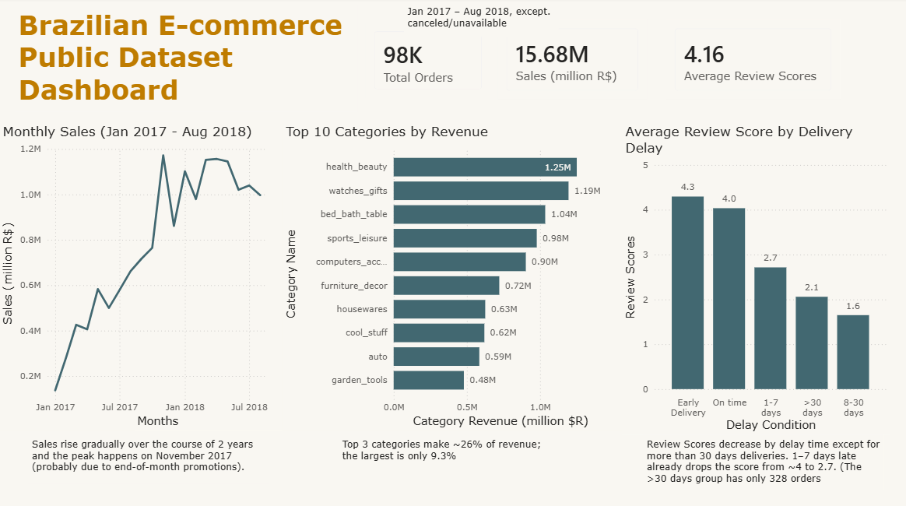

<div dir="rtl">

# تحلیل فروشگاه آنلاین Olist (SQL · Python · Power BI)

تحلیل کامل دیتاست عمومی فروشگاه آنلاین برزیلی Olist](https://www.kaggle.com/datasets/olistbr/brazilian-ecommerce) (حدود 98 هزار سفارش، سال‌های ۲۰۱۶ تا ۲۰۱۸). این پروژه شامل ورود داده، بررسی کیفیت داده، پاک‌سازی، شش تحلیل کسب‌وکاری در SQL، راستی‌آزمایی مستقل با pandas و یک داشبورد یک‌صفحه‌ای Power BI است.

**ابزارها:** MySQL (Workbench) · Python (pandas، matplotlib، Jupyter) · Power BI



---

## سؤال‌های کسب‌وکار

۱. روند فروش ماهانه چیست و آیا دوره‌ی اوج وجود دارد؟
۲. کدام دسته‌های محصول بیشترین درآمد را دارند؟
۳. تأخیر در تحویل چه تأثیری روی امتیاز نظرها دارد؟
۴. تأخیر تحویل در کدام ایالت‌ها بیشتر است؟
۵. مشتری‌ها بیشتر از کدام ایالت‌ها هستند؟
۶. چند درصد مشتری‌ها بیش از یک بار خرید کرده‌اند؟

## یافته‌ها و توصیه‌ها

| #   | سؤال           | یافته                                                                                                                                                                                                                                                               |
| --- | -------------- | ------------------------------------------------------------------------------------------------------------------------------------------------------------------------------------------------------------------------------------------------------------------- |
| ۱   | فروش ماهانه    | فروش از حدود ۰٫۱۴ میلیون R$ (ژانویه ۲۰۱۷) به اوج حدود ۱٫۱۸ میلیون R$ در نوامبر ۲۰۱۷ رسید (احتمالاً به‌دلیل تخفیف‌های پایان ماه؛ داده علت را نشان نمی‌دهد) و بعد تقریباً بین ۰٫۹ تا ۱٫۲ میلیون ماند. کل فروش ژانویه ۲۰۱۷ تا اوت ۲۰۱۸: ۱۵٫۶۸ میلیون R$ (قیمت + کرایه) |
| ۲   | درآمد دسته‌ها  | درآمد پراکنده است. سه دسته‌ی اول `health_beauty` (۹٫۳٪)، `watches_gifts` (۸٫۹٪) و `bed_bath_table` (۷٫۷٪) هستند و روی هم حدود ۲۶٪ درآمد را می‌سازند                                                                                                                 |
| ۳   | تأخیر و امتیاز | سفارش‌های دیرکرده امتیاز بسیار پایین‌تری دارند (جدول زیر). حتی تأخیر ۱ تا ۷ روزه میانگین را از حدود ۴ به ۲٫۷ می‌رساند                                                                                                                                               |
| ۴   | تأخیر هر ایالت | سهم سفارش‌های دیرکرده بین ایالت‌ها از حدود ۲٫۸٪ تا حدود ۲۱٫۵٪ متغیر است. ایالت‌های کم‌سفارش پرنوسان‌اند، پس مقایسه باید روی ایالت‌های پرسفارش تمرکز کند                                                                                                             |
| ۵   | مشتری هر ایالت | ایالت SP حدود ۴۲٪ مشتری‌ها را دارد و کوچک‌ترین ایالت (RR) حدود ۰٫۰۵٪                                                                                                                                                                                                |
| ۶   | مشتری تکراری   | فقط حدود **۳٪** مشتری‌ها بیش از یک سفارش داده‌اند                                                                                                                                                                                                                   |

**تأخیر تحویل در برابر میانگین امتیاز** (سفارش‌های تحویل‌شده‌ی دارای نظر، ژانویه ۲۰۱۷ تا اوت ۲۰۱۸)

| گروه تأخیر        | تعداد سفارش | میانگین امتیاز |
| ----------------- | ----------- | -------------- |
| زودتر از موعد     | ۸۷٬۹۰۲      | ۴٫۳۰           |
| به‌موقع           | ۱٬۲۸۰       | ۴٫۰۴           |
| ۱ تا ۷ روز دیر    | ۳٬۵۹۹       | ۲٫۷۲           |
| ۸ تا ۳۰ روز دیر   | ۲٬۴۵۱       | ۱٫۶۵           |
| بیش از ۳۰ روز دیر | ۳۲۸         | ۲٫۰۶           |

گروه «بیش از ۳۰ روز» از گروه «۸ تا ۳۰ روز» امتیاز بالاتری دارد. فقط ۳۲۸ سفارش دارد و داده علتش را توضیح نمی‌دهد.

**توصیه‌ها**

- **کاهش تأخیر، حتی تأخیرهای کوتاه.** سفارش‌های دیرکرده با امتیاز بسیار پایین‌تر همراه‌اند و گروه ۱ تا ۷ روز به‌تنهایی ۳٬۵۹۹ سفارش دارد.
- **بررسی نگه‌داشت مشتری.** حدود ۹۷٪ مشتری‌ها فقط یک بار خرید کرده‌اند. اینکه سرمایه‌گذاری روی نگه‌داشت ارزش دارد یا نه، به هزینه‌ی جذب مشتری و حاشیه‌ی سود بستگی دارد که در این داده نیست.
- **درآمد در یک دسته متمرکز نیست** (بزرگ‌ترین دسته ۹٫۳٪ است)، پس ریسک وابستگی به یک دسته پایین است.

## کیفیت داده

همه‌ی چک‌ها در `sql/04_data_quality_check.sql` هستند. یافته‌ها و تصمیم‌ها:

| چک                               | یافته                                                                                                                                                | تصمیم                                                                                           |
| -------------------------------- | ---------------------------------------------------------------------------------------------------------------------------------------------------- | ----------------------------------------------------------------------------------------------- |
| بازه‌ی تاریخ                     | سپتامبر ۲۰۱۶ تا اکتبر ۲۰۱۸. سال ۲۰۱۶ و ماه‌های سپتامبر و اکتبر ۲۰۱۸ ناقص‌اند (نوامبر ۲۰۱۶ سفارشی ندارد؛ سپتامبر و اکتبر ۲۰۱۸ فقط ۱۶ و ۴ سفارش دارند) | روند ماهانه فقط برای ژانویه ۲۰۱۷ تا اوت ۲۰۱۸                                                    |
| سفارش delivered بدون تاریخ تحویل | ۸ سفارش                                                                                                                                              | از تحلیل تأخیر کنار گذاشته شد، در فروش نگه داشته شد                                             |
| ناسازگاری ترتیب تاریخ‌ها         | ۱٬۳۵۹ سفارش تحویل به پست قبل از تأیید پرداخت دارند؛ ۲۳ سفارش تحویل به مشتری قبل از تحویل به پست؛ ۲ سفارش تحویل به پست قبل از خرید                    | این ستون‌ها در هیچ تحلیلی استفاده نشدند. ردیف‌ها نگه داشته شدند (احتمالاً خطای ثبت، علت نامشخص) |
| سفارش بدون آیتم                  | ۷۷۵ (بیشترشان `unavailable` و `canceled`)                                                                                                            | وارد تحلیل فروش نمی‌شوند                                                                        |
| سفارش بدون نظر                   | ۷۶۸                                                                                                                                                  | وارد تحلیل امتیاز نمی‌شوند                                                                      |
| سفارش با چند نظر                 | حدود ۵۵۰ ردیف نظر اضافه                                                                                                                              | برای هر سفارش یک امتیاز (میانگین نظرهای آن)                                                     |
| یکپارچگی کلیدها                  | سفارش بدون مشتری: ۰، آیتم بدون محصول: ۰                                                                                                              | بدون اقدام                                                                                      |
| مشتری در بیش از یک ایالت         | ۴۰ مورد (از ۹۶٬۰۹۶ مشتری یکتا)                                                                                                                       | نگه داشته شد؛ در هر ایالت جدا شمرده شد                                                          |
| محصول بدون دسته                  | ۶۱۰                                                                                                                                                  | در تحلیل دسته‌ها با برچسب `unknown`                                                             |
| دسته‌ی بدون ترجمه‌ی انگلیسی      | ۲                                                                                                                                                    | با نام پرتغالی نمایش داده شد                                                                    |

**پاک‌سازی (`sql/03_cleaning.sql`)**

- جدول‌های خام دست‌نخورده ماندند و برای `order_reviews` و `products` نسخه‌ی پاک‌سازی‌شده (`*_clean`) ساخته شد.
- رشته‌های خالی در ستون‌های متنی به `NULL` تبدیل شدند، چون `IS NULL` رشته‌ی خالی را نمی‌گیرد و شمارش و میانگین را غلط می‌کند.
- یک ردیف نظر هنگام ورود از CSV شکست (تاریخ‌ها داخل متن نظر افتادند) و از روی CSV ترمیم شد. ردیف بعدی هم در همان خرابی از دست رفته بود و دوباره اضافه شد.

**راستی‌آزمایی در pandas:** تعداد ردیف‌ها و تعداد مقدارهای خالی با جدول‌های SQL یکی بود. فروش ماهانه، درآمد دسته‌ها و جدول تأخیر و امتیاز هم با نتیجه‌ی SQL برابر شد.

## تعریف‌ها

- **فروش** (روند ماهانه) = `price + freight_value`. **درآمد دسته** = فقط `price`.
- سفارش‌های واردشده: همه‌ی وضعیت‌ها به‌جز `canceled` و `unavailable`، با تاریخ خرید از ۲۰۱۷-۰۱-۰۱ تا ۲۰۱۸-۰۸-۳۱.
- **تأخیر** = تاریخ واقعی تحویل منهای تاریخ تخمینی، به روز تقویمی (مثبت یعنی دیر).
- تحلیل تأخیر: سفارش‌های `delivered` که تاریخ تحویل و حداقل یک نظر دارند.
- **مشتری** یعنی `customer_unique_id` (چون `customer_id` برای هر سفارش جدید می‌شود).

## محدودیت‌ها

- داده حدود دو سال است و فقط یک نوامبر دارد، پس نمی‌توان از فصل‌بندی حرف زد.
- تأخیر و امتیاز با هم **همراه‌اند**، ولی این تحلیل علت‌ومعلولی بودن را ثابت نمی‌کند.
- در تحلیل امتیاز فقط مشتری‌هایی هستند که نظر گذاشته‌اند.
- نرخ خرید تکراری به کوتاهی بازه محدود است: مشتری‌های اخیر فرصت کمی برای خرید دوم داشتند.
- داده‌ی هزینه و حاشیه‌ی سود وجود ندارد، پس سودآوری تحلیل نشده است.

## ساختار پروژه

```
├── README.md
├── sql/
│   ├── 01_import.sql
│   ├── 02_data_exploration.sql
│   ├── 03_cleaning.sql
│   ├── 04_data_quality_check.sql
│   └── 05_data_analysis.sql
├── notebooks/
│   └── 06_analysis_pandas.ipynb
├── dashboard/
│   └── dashboard.pbix
│   └── dashboard.pdf

│   └── dashboard.png

├── data/processed/        # جدول‌های خلاصه کوچک
│   └── Category_Revenue.csv
│   └── Monthly_Sales.csv
│   └── Review_by_Delay.csv

└── images/
```

## نحوه‌ی اجرا

۱. دیتاست را از Kaggle دانلود کن (فایل‌های CSV خام اینجا نیستند)
۲. در MySQL Workbench، گزینه‌ی `OPT_LOCAL_INFILE=1` را در بخش Advanced تنظیمات کانکشن فعال کن و دستور `SET GLOBAL local_infile = 1;` را اجرا کن.
۳. مسیر فایل‌ها را در `sql/01_import.sql` عوض کن و فایل‌های SQL را به ترتیب (۰۱ تا ۰۵) اجرا کن.
۴. برای نوت‌بوک: `pip install pandas matplotlib jupyter` و مسیر پوشه‌ی داده را در اولین سلول عوض کن.
۵. فایل `dashboard/dashboard.pbix` را در Power BI Desktop باز کن.

</div>
