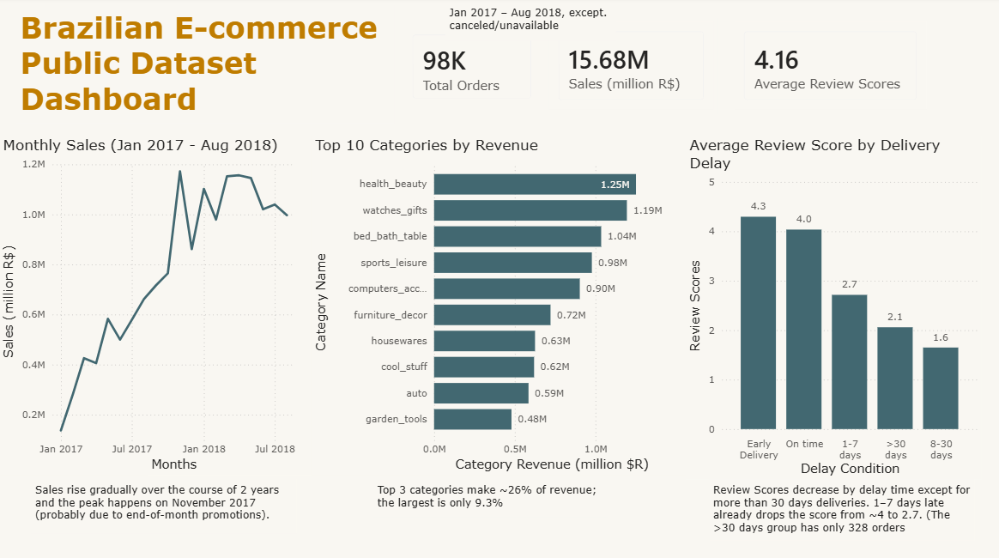

# Olist E-commerce Analysis (SQL · Python · Power BI)

End-to-end analysis of the [Brazilian E-Commerce Public Dataset by Olist](https://www.kaggle.com/datasets/olistbr/brazilian-ecommerce) (about 99K orders, 2016–2018). The project covers data import, data-quality checks, cleaning, six business analyses in SQL, independent verification in pandas, and a one-page Power BI dashboard.

**Tools:** MySQL (Workbench) · Python (pandas, matplotlib, Jupyter) · Power BI



---

## Business Questions

1. What is the monthly sales trend, and is there a peak period?# Olist E-commerce Analysis (SQL · Python · Power BI)

End-to-end analysis of the [Brazilian E-Commerce Public Dataset by Olist](https://www.kaggle.com/datasets/olistbr/brazilian-ecommerce) (about 99K orders, 2016–2018). The project covers data import, data-quality checks, cleaning, six business analyses in SQL, independent verification in pandas, and a one-page Power BI dashboard.

**Tools:** MySQL (Workbench) · Python (pandas, matplotlib, Jupyter) · Power BI


---

## Business Questions

1. What is the monthly sales trend, and is there a peak period?
2. Which product categories bring the most revenue?
3. How does delivery delay affect review scores?
4. Which states have the highest share of late deliveries?
5. Which states do most customers come from?
6. What share of customers buy more than once?

## Key Findings and Recommendations

| #   | Question                 | Finding                                                                                                                                                                                                                                                           |
| --- | ------------------------ | ----------------------------------------------------------------------------------------------------------------------------------------------------------------------------------------------------------------------------------------------------------------- |
| 1   | Monthly sales            | Sales grew from about 0.14M R$ (Jan 2017) to a peak of about 1.18M R$ in Nov 2017 (probably end-of-month promotions; the data does not show the cause), then stayed roughly between 0.9M and 1.2M. Total sales Jan 2017–Aug 2018: **15.68M R$** (price + freight) |
| 2   | Category revenue         | Revenue is spread out: the top three categories are `health_beauty` (9.3%), `watches_gifts` (8.9%) and `bed_bath_table` (7.7%), about 26% together                                                                                                                |
| 3   | Delay vs. score          | Late orders have much lower scores (table below). Even a 1–7 day delay drops the average from about 4 to 2.7                                                                                                                                                      |
| 4   | Late deliveries by state | The late-delivery share ranges from about 2.8% to about 21.5% between states. States with few orders are noisy, so comparisons should focus on states with many orders                                                                                            |
| 5   | Customers by state       | São Paulo (SP) holds about 42% of customers; the smallest state (RR) about 0.05%                                                                                                                                                                                  |
| 6   | Repeat customers         | Only about **3%** of customers placed more than one order                                                                                                                                                                                                         |

**Delivery delay vs. average review score** (delivered orders with a review, Jan 2017–Aug 2018)

| Delay group            | Orders | Avg. review score |
| ---------------------- | ------ | ----------------- |
| Early                  | 87,902 | 4.30              |
| On time                | 1,280  | 4.04              |
| 1–7 days late          | 3,599  | 2.72              |
| 8–30 days late         | 2,451  | 1.65              |
| More than 30 days late | 328    | 2.06              |

The >30 days group scores higher than the 8–30 days group. It has only 328 orders, and the data does not explain why.

**Recommendations**

- **Reduce delivery delays, even short ones.** Late orders are linked to much lower scores, and the 1–7 day group alone contains 3,599 orders.
- **Look into customer retention.** About 97% of customers bought once. Whether retention is worth the investment depends on acquisition cost and margins, which are not in this dataset.
- **Revenue is not concentrated in one category** (the largest has 9.3%), so category-level risk is spread out.

## Data Quality

All checks are in `sql/04_data_quality_check.sql`. Findings and decisions:

| Check                                     | Finding                                                                                                                                          | Decision                                                                                       |
| ----------------------------------------- | ------------------------------------------------------------------------------------------------------------------------------------------------ | ---------------------------------------------------------------------------------------------- |
| Date range                                | Sep 2016 to Oct 2018. 2016 and Sep/Oct 2018 are incomplete (Nov 2016 has no orders; Sep and Oct 2018 have 16 and 4)                              | Monthly trend uses Jan 2017–Aug 2018 only                                                      |
| Delivered orders without a delivery date  | 8                                                                                                                                                | Excluded from delay analysis, kept in sales                                                    |
| Date order inconsistencies                | 1,359 orders have carrier pickup before payment approval; 23 have customer delivery before carrier pickup; 2 have carrier pickup before purchase | These columns are not used in any analysis. Rows kept (likely recording issues, cause unknown) |
| Orders without items                      | 775 (mostly `unavailable` and `canceled`)                                                                                                        | Not part of sales analysis                                                                     |
| Orders without reviews                    | 768                                                                                                                                              | Not part of score analysis                                                                     |
| Orders with several reviews               | about 550 extra review rows                                                                                                                      | One score per order (average of its reviews)                                                   |
| Key integrity                             | 0 orders without a customer, 0 items without a product                                                                                           | No action                                                                                      |
| Customers in more than one state          | 40 (out of 96,096 unique customers)                                                                                                              | Kept; counted in each state                                                                    |
| Products without a category               | 610                                                                                                                                              | Shown as `unknown` in category analysis                                                        |
| Categories without an English translation | 2                                                                                                                                                | Shown with their Portuguese name                                                               |

**Cleaning (`sql/03_cleaning.sql`)**

- Raw tables were kept untouched; cleaned copies were created for `order_reviews` and `products` (`*_clean`).
- Empty strings were converted to `NULL` in text columns, because `IS NULL` does not catch empty strings and counts or averages would be wrong.
- One review row broke during CSV import (dates ended up inside the comment text) and was repaired from the CSV. The row after it was lost in the same import and was re-inserted.

**Cross-check in pandas:** row counts and null counts matched the SQL tables, and monthly sales, category revenue and the delay/score table matched the SQL results.

## Definitions

- **Sales** (monthly trend) = `price + freight_value`. **Category revenue** = `price` only.
- Included orders: all statuses except `canceled` and `unavailable`, purchased from 2017-01-01 to 2018-08-31.
- **Delay** = actual delivery date minus estimated delivery date, in calendar days (positive = late).
- Delay analysis uses `delivered` orders with a delivery date and at least one review.
- A **customer** is a `customer_unique_id` (`customer_id` changes with every order).

## Limitations

- The data covers about two years; there is only one November, so seasonality cannot be claimed.
- Delay and review scores are **associated**, but this analysis does not prove delay causes low scores.
- Only customers who left a review are included in score analysis.
- Repeat-purchase rate is limited by the short window: recent customers had little time to buy again.
- No cost or margin data, so profitability is not analyzed.

## Project Structure

```
├── README.md
├── sql/
│   ├── 01_import.sql
│   ├── 02_data_exploration.sql
│   ├── 03_cleaning.sql
│   ├── 04_data_quality_check.sql
│   └── 05_data_analysis.sql
├── notebooks/
│   └── 06_analysis_pandas.ipynb
├── dashboard/
│   └── dashboard.pbix
│   └── dashboard.pdf

│   └── dashboard.png

├── data/processed/        # small summary tables used by the dashboard
│   └── Category_Revenue.csv
│   └── Monthly_Sales.csv
│   └── Review_by_Delay.csv

└── images/
```

## How to Run

1. Download the dataset from Kaggle (raw CSVs are not included in this repository).
2. In MySQL Workbench, enable `OPT_LOCAL_INFILE=1` in the connection's Advanced options, then run `SET GLOBAL local_infile = 1;`.
3. Edit the file paths in `sql/01_import.sql`, then run the SQL files in order (01 to 05).
4. For the notebook: `pip install pandas matplotlib jupyter`, and set the data folder path in the first cell.
5. Open `dashboard/dashboard.pbix` in Power BI Desktop

2. Which product categories bring the most revenue?
3. How does delivery delay affect review scores?
4. Which states have the highest share of late deliveries?
5. Which states do most customers come from?
6. What share of customers buy more than once?

## Key Findings and Recommendations

| #   | Question                 | Finding                                                                                                                                                                                                                                                           |
| --- | ------------------------ | ----------------------------------------------------------------------------------------------------------------------------------------------------------------------------------------------------------------------------------------------------------------- |
| 1   | Monthly sales            | Sales grew from about 0.14M R$ (Jan 2017) to a peak of about 1.18M R$ in Nov 2017 (probably end-of-month promotions; the data does not show the cause), then stayed roughly between 0.9M and 1.2M. Total sales Jan 2017–Aug 2018: **15.68M R$** (price + freight) |
| 2   | Category revenue         | Revenue is spread out: the top three categories are `health_beauty` (9.3%), `watches_gifts` (8.9%) and `bed_bath_table` (7.7%), about 26% together                                                                                                                |
| 3   | Delay vs. score          | Late orders have much lower scores (table below). Even a 1–7 day delay drops the average from about 4 to 2.7                                                                                                                                                      |
| 4   | Late deliveries by state | The late-delivery share ranges from about 2.8% to about 21.5% between states. States with few orders are noisy, so comparisons should focus on states with many orders                                                                                            |
| 5   | Customers by state       | São Paulo (SP) holds about 42% of customers; the smallest state (RR) about 0.05%                                                                                                                                                                                  |
| 6   | Repeat customers         | Only about **3%** of customers placed more than one order                                                                                                                                                                                                         |

**Delivery delay vs. average review score** (delivered orders with a review, Jan 2017–Aug 2018)

| Delay group            | Orders | Avg. review score |
| ---------------------- | ------ | ----------------- |
| Early                  | 87,902 | 4.30              |
| On time                | 1,280  | 4.04              |
| 1–7 days late          | 3,599  | 2.72              |
| 8–30 days late         | 2,451  | 1.65              |
| More than 30 days late | 328    | 2.06              |

The >30 days group scores higher than the 8–30 days group. It has only 328 orders, and the data does not explain why.

**Recommendations**

- **Reduce delivery delays, even short ones.** Late orders are linked to much lower scores, and the 1–7 day group alone contains 3,599 orders.
- **Look into customer retention.** About 97% of customers bought once. Whether retention is worth the investment depends on acquisition cost and margins, which are not in this dataset.
- **Revenue is not concentrated in one category** (the largest has 9.3%), so category-level risk is spread out.

## Data Quality

All checks are in `sql/04_data_quality_check.sql`. Findings and decisions:

| Check                                     | Finding                                                                                                                                          | Decision                                                                                       |
| ----------------------------------------- | ------------------------------------------------------------------------------------------------------------------------------------------------ | ---------------------------------------------------------------------------------------------- |
| Date range                                | Sep 2016 to Oct 2018. 2016 and Sep/Oct 2018 are incomplete (Nov 2016 has no orders; Sep and Oct 2018 have 16 and 4)                              | Monthly trend uses Jan 2017–Aug 2018 only                                                      |
| Delivered orders without a delivery date  | 8                                                                                                                                                | Excluded from delay analysis, kept in sales                                                    |
| Date order inconsistencies                | 1,359 orders have carrier pickup before payment approval; 23 have customer delivery before carrier pickup; 2 have carrier pickup before purchase | These columns are not used in any analysis. Rows kept (likely recording issues, cause unknown) |
| Orders without items                      | 775 (mostly `unavailable` and `canceled`)                                                                                                        | Not part of sales analysis                                                                     |
| Orders without reviews                    | 768                                                                                                                                              | Not part of score analysis                                                                     |
| Orders with several reviews               | about 550 extra review rows                                                                                                                      | One score per order (average of its reviews)                                                   |
| Key integrity                             | 0 orders without a customer, 0 items without a product                                                                                           | No action                                                                                      |
| Customers in more than one state          | 40 (out of 96,096 unique customers)                                                                                                              | Kept; counted in each state                                                                    |
| Products without a category               | 610                                                                                                                                              | Shown as `unknown` in category analysis                                                        |
| Categories without an English translation | 2                                                                                                                                                | Shown with their Portuguese name                                                               |

**Cleaning (`sql/03_cleaning.sql`)**

- Raw tables were kept untouched; cleaned copies were created for `order_reviews` and `products` (`*_clean`).
- Empty strings were converted to `NULL` in text columns, because `IS NULL` does not catch empty strings and counts or averages would be wrong.
- One review row broke during CSV import (dates ended up inside the comment text) and was repaired from the CSV. The row after it was lost in the same import and was re-inserted.

**Cross-check in pandas:** row counts and null counts matched the SQL tables, and monthly sales, category revenue and the delay/score table matched the SQL results.

## Definitions

- **Sales** (monthly trend) = `price + freight_value`. **Category revenue** = `price` only.
- Included orders: all statuses except `canceled` and `unavailable`, purchased from 2017-01-01 to 2018-08-31.
- **Delay** = actual delivery date minus estimated delivery date, in calendar days (positive = late).
- Delay analysis uses `delivered` orders with a delivery date and at least one review.
- A **customer** is a `customer_unique_id` (`customer_id` changes with every order).

## Limitations

- The data covers about two years; there is only one November, so seasonality cannot be claimed.
- Delay and review scores are **associated**, but this analysis does not prove delay causes low scores.
- Only customers who left a review are included in score analysis.
- Repeat-purchase rate is limited by the short window: recent customers had little time to buy again.
- No cost or margin data, so profitability is not analyzed.

## Project Structure

```
├── README.md
├── sql/
│   ├── 01_import.sql
│   ├── 02_data_exploration.sql
│   ├── 03_cleaning.sql
│   ├── 04_data_quality_check.sql
│   └── 05_data_analysis.sql
├── notebooks/
│   └── 06_analysis_pandas.ipynb
├── dashboard/
│   └── dashboard.pbix
│   └── dashboard.pdf

│   └── dashboard.png

├── data/processed/        # small summary tables used by the dashboard
│   └── Category_Revenue.csv
│   └── Monthly_Sales.csv
│   └── Review_by_Delay.csv

└── images/
```

## How to Run

1. Download the dataset from Kaggle (raw CSVs are not included in this repository).
2. In MySQL Workbench, enable `OPT_LOCAL_INFILE=1` in the connection's Advanced options, then run `SET GLOBAL local_infile = 1;`.
3. Edit the file paths in `sql/01_import.sql`, then run the SQL files in order (01 to 05).
4. For the notebook: `pip install pandas matplotlib jupyter`, and set the data folder path in the first cell.
5. Open `dashboard/dashboard.pbix` in Power BI Desktop
